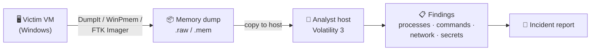

<div align="center">

# 🧠 Memory Forensics with Volatility 3

### A hands-on, beginner-friendly lab journal — from zero to investigating RAM


*Capture it. Parse it. Tell the story of what happened.*

</div>

---

## 📑 Table of Contents

1. [What is Memory Forensics?](#-what-is-memory-forensics)
2. [Lab Architecture](#-lab-architecture)
3. [Installation (Windows)](#-installation-windows)
4. [Your First Command](#-your-first-command)
5. [Lab 0 — MemLabs "Challenge.raw"](#-lab-0--memlabs-challengeraw)
6. [Using the GUI: Volatility Workbench](#-using-the-gui-volatility-workbench)
7. [Lab 1 — "The Suspicious Process" (build your own)](#-lab-1--the-suspicious-process-build-your-own)
8. [Plugin Cheat Sheet](#-plugin-cheat-sheet)
9. [Troubleshooting](#-troubleshooting)
10. [Resources](#-resources)

---

## 🔍 What is Memory Forensics?

**Memory (RAM) forensics** is the analysis of a snapshot of a computer's RAM. Unlike a hard drive, RAM holds what was *happening right now*: running programs, typed commands, network connections, unsaved text, and even password hashes. All of it disappears when the machine powers off.

**Volatility 3** is a free, open-source, command-line framework (written in Python) that reads a raw memory dump and turns it into readable evidence using **plugins** (`pslist`, `netscan`, `envars`, …).

| Forensics type | Examines | Example tool |
|---|---|---|
| 🧠 **Memory** | RAM: live activity | **Volatility 3** |
| 💽 Disk | Saved & deleted files, history | Autopsy, FTK Imager |
| 🌐 Network | Packets & traffic | Wireshark |

> [!NOTE]
> Volatility doesn't need the original computer, and it doesn't need Windows 7 installed to analyze a Windows 7 dump. It only needs **the dump file** plus a **symbol file** (a "map" of how that OS lays out its data), which it downloads automatically.

---

## 🏗️ Lab Architecture



| Role | Machine | What runs there |
|---|---|---|
| **Investigator** | Your host PC | Volatility 3 / Volatility Workbench |
| **Victim** | A virtual machine | The "scene": programs, commands, activity |

> [!TIP]
> Install Volatility on the **host**, not inside the VM. Your tools stay clean, and you can roll the VM back to a snapshot at any time.

---

## ⚙️ Installation (Windows)

### 1. Install Python

```bat
python --version
```

If this shows `Python 3.8` or newer, skip ahead. Otherwise, download Python from [python.org/downloads](https://www.python.org/downloads/).

> [!IMPORTANT]
> On the installer's first screen, tick **"Add python.exe to PATH"**, then open a **new** CMD window.

### 2. Get the source code

```bat
cd /d %USERPROFILE%
git clone https://github.com/volatilityfoundation/volatility3.git
cd volatility3
```

<sub>No Git? On the GitHub page, click **Code → Download ZIP**, extract it, and `cd` into the folder.</sub>

### 3. Create & activate a virtual environment

```bat
python -m venv venv
venv\Scripts\activate
```

Your prompt should now start with **`(venv)`**.

### 4. Install Volatility and its extras

```bat
pip install -e ".[full]"
```

### 5. Verify

```bat
python vol.py -h
```

A long list of plugins means it's installed. ✅

> [!WARNING]
> **Don't type `vol -h` in CMD.** `vol` is a built-in CMD command that prints a drive's volume label, so you'll get *"The system cannot find the drive specified."* In CMD, use **`python vol.py`** or **`vol.exe`** instead. PowerShell doesn't have this clash.

### Every session after that

```bat
cd /d %USERPROFILE%\volatility3
venv\Scripts\activate
python vol.py -f <path-to-dump> <plugin>
```

> [!TIP]
> **Shortcut:** `pip install volatility3` installs the stable release in one command, with no clone needed.

---

## 🚀 Your First Command

Every Volatility command has the same shape:

```bat
python vol.py  -f <memory file>  <plugin>
```

Start every investigation with `windows.info`:

```bat
python vol.py -f C:\Users\Administrator\Downloads\Challenge\Challenge.raw windows.info
```

<details>
<summary><b>📖 How to read the output</b></summary>

| Field | Example | Meaning |
|---|---|---|
| `NTBuildLab` | `7601...win7sp1` | Windows 7 SP1; `x86` = 32-bit |
| `NtMajor/MinorVersion` | `6` / `1` | Internal version 6.1 = Windows 7 |
| `Is64Bit` | `False` | 32-bit system |
| `IsPAE` | `True` | 32-bit Windows using >4 GB addressing |
| `KeNumberProcessors` | `1` | One CPU |
| `SystemTime` | `2018-10-23 08:30:51` | **When the memory was captured (UTC)** |
| `NtSystemRoot` | `C:\Windows` | Windows install folder |
| `Symbols` | `ntkrpamp.pdb/...json.xz` | The symbol "map" Volatility downloaded |
| `Kernel Base` / `DTB` | `0x82604000` / `0x185000` | Internal addresses Volatility uses to navigate RAM |

</details>

> [!NOTE]
> The **first run is slow** because Volatility downloads the symbol file. Keep the internet on. Later runs are fast.

---

## 🧪 Lab 0 — MemLabs "Challenge.raw"

> **Source:** [stuxnet999/MemLabs — Lab 0](https://github.com/stuxnet999/MemLabs/tree/master/Lab%200)
> **Goal:** Reconstruct what the user did and recover the hidden flag.

### 📥 Getting the file

The download is `Challenge.tar.xz` (~90 MB), which extracts to **`Challenge.raw` (~1 GB)**. Extract it with **7-Zip**, or in CMD:

```bat
tar -xf Challenge.tar.xz
```

> [!CAUTION]
> A memory dump is **never** an `.exe`. If a download page gives you an executable, it came from an ad. Delete it and download again from the link in the lab's README.

### 🕵️ Investigation

```bat
set DUMP=C:\Users\Administrator\Downloads\Challenge\Challenge.raw
python vol.py -f %DUMP% windows.info
python vol.py -f %DUMP% windows.pslist
python vol.py -f %DUMP% windows.cmdline
python vol.py -f %DUMP% windows.envars
python vol.py -f %DUMP% windows.registry.hashdump
```

### 🗓️ Reconstructed timeline (UTC, 23 Oct 2018)

| Time | Event | Evidence |
|---|---|---|
| `08:29:16` | System boots: **VirtualBox** VM, Windows 7 SP1 x86 | `windows.info`, `VBoxService.exe` |
| `~08:30` | User **`hello`** logs on to **`HELLO-PC`** | `windows.envars` |
| `08:30:18` | **`cmd.exe`** opened (PID 2096) | `windows.pslist` |
| *after* | Runs `C:\Python27\python.exe C:\Users\hello\Desktop\demon.py.txt` | String search of memory |
| `08:30:48` | **`DumpIt.exe`** launched to capture RAM | `windows.pslist` / `cmdline` |
| `08:30:51` | Memory snapshot taken | `windows.info` |

### 💡 Key clue

`windows.envars` reveals a custom environment variable in the `cmd.exe` process:

```text
Thanos    xor and password
```

So the flag is built from **two pieces**: an XOR-encoded value printed by `demon.py.txt`, and the user's **password**.

### 🧩 Solving it

<details>
<summary><b>Step 1: Find what the script printed</b></summary>

Dump the console host's memory (`conhost.exe`, PID **2104**):

```bat
mkdir out
python vol.py -f %DUMP% -o out windows.memmap --pid 2104 --dump
```

Then search `out\pid.2104.dmp` for hex strings:

```bat
python scripts\find_hex.py out\pid.2104.dmp
```

Or open the file in **HxD**, press `Ctrl+F`, and search for `demon` (try both ANSI and Unicode). The script's output appears near the command.

</details>

<details>
<summary><b>Step 2: Recover the password</b></summary>

```bat
python vol.py -f %DUMP% windows.registry.hashdump
```

| User | RID | NT hash |
|---|---|---|
| hello | 1000 | `101da33f44e92c27835e64322d72e8b7` |

Paste the **NT hash** into [crackstation.net](https://crackstation.net).

> `aad3b435b51404eeaad3b435b51404ee` in the LM column is Windows' **empty LM hash** placeholder. It isn't a clue.

</details>

<details>
<summary><b>Step 3: Decode the XOR</b></summary>

```bat
python scripts\xor_try.py <hex-string>
```

Or in [CyberChef](https://gchq.github.io/CyberChef): **From Hex → XOR Brute Force**, then look for readable output.

Combine the decoded text and the password using the flag format given in the Lab 0 README.

</details>

> [!WARNING]
> On this **32-bit Windows 7** dump, `windows.cmdscan` and `windows.consoles` fail with *"This version of Windows is not supported"*. That's a Volatility 3 limitation, not a mistake on your end. Searching memory for strings is the workaround.

### 🎓 Skills practised

`windows.info` · `pslist` · `cmdline` · `envars` · `registry.hashdump` · `memmap --dump` · string hunting · XOR decoding · hash cracking

---

## 🖱️ Using the GUI: Volatility Workbench

Prefer buttons over commands? **[Volatility Workbench](https://www.osforensics.com/tools/volatility-workbench.html)** by PassMark is a free Windows GUI that bundles Volatility 3.

| Step | Action |
|---|---|
| 1 | Download `VolatilityWorkbench.zip`, extract it, and run `VolatilityWorkbench.exe` |
| 2 | **Browse Image** → select your `.raw` / `.mem` file |
| 3 | Select **Windows** as the platform, then **Get Process List** |
| 4 | Pick a plugin from the **Command** dropdown |
| 5 | Add parameters if needed (e.g. `--pid 2104 --dump`), then click **Run** |
| 6 | Copy output, or right-click → **Save** to keep it |

### 🧰 Companion GUI tools

| Tool | Use it for |
|---|---|
| [HxD](https://mh-nexus.de/en/hxd/) | Searching dumped process memory for text |
| [CyberChef](https://gchq.github.io/CyberChef) | Decoding hex, Base64, XOR, … in the browser |
| [CrackStation](https://crackstation.net) | Looking up NTLM hashes |

---

## 🎯 Lab 1 — "The Suspicious Process" (build your own)

> **Scenario:** A user reports their PC is "acting weird." You capture its RAM and work out what was running, what was typed, and what doesn't belong.

### 🅰️ Part A: Stage the scene (inside the Windows VM)

> [!IMPORTANT]
> **Take a VM snapshot first**, and keep the VM on a **host-only** network.

**1. Plant a look-alike process** (it's harmless Notepad under a fake name):

```bat
copy C:\Windows\System32\notepad.exe C:\Users\Public\svch0st.exe
start C:\Users\Public\svch0st.exe
```

**2. Leave a secret in RAM.** Type `MySecretPass123` into that Notepad window. **Don't save.**

**3. Generate command history:**

```bat
whoami
ipconfig
ping 8.8.8.8 -n 2
```

**4. Open a browser** and leave a website open.

**5. Capture memory.** Run **DumpIt** / **WinPmem** as Administrator, or use **FTK Imager → File → Capture Memory**.

**6. Copy the dump to the host**, then **revert the snapshot**.

### 🅱️ Part B: Investigate

| # | Question | Plugin |
|:-:|---|---|
| 1 | Which OS is this, and when was it captured? | `windows.info` |
| 2 | Which process name looks **fake**? | `windows.pslist` |
| 3 | Where was it launched from? Why is that suspicious? | `windows.cmdline` |
| 4 | Who is its **parent** process? | `windows.pstree` |
| 5 | What commands were typed? | `windows.cmdscan` / `windows.consoles` |
| 6 | What was the PC connected to, and by which process? | `windows.netscan` |
| 7 | What are the username and computer name? | `windows.envars` |
| 8 | Can you recover the **unsaved** Notepad text? | `windows.memmap --pid <PID> --dump` + HxD (Unicode search) |

### 🅲 Part C: Report

Write a 4–5 sentence incident summary covering **what** happened, **when**, **which process** was suspicious, and **why**.

<details>
<summary><b>🔑 Answer key (try first!)</b></summary>

| # | Answer |
|:-:|---|
| 2 | `svch0st.exe` (a zero instead of an "o") |
| 3 | `C:\Users\Public\`. Real system binaries live in `C:\Windows\System32` |
| 4 | `cmd.exe`. A real `svchost.exe` is always started by `services.exe` 🚩 |
| 5 | `whoami`, `ipconfig`, `ping 8.8.8.8 -n 2` |
| 6 | The browser's connections, plus traces of the ping to `8.8.8.8` |
| 8 | `MySecretPass123`, recovered from RAM even though it was never saved |

</details>

> [!TIP]
> Use a **Windows 10/11** VM so that `cmdscan` and `consoles` work. To raise the difficulty, have a friend stage the scene without telling you what they did.

---

## 📋 Plugin Cheat Sheet

| Category | Plugin | What it shows |
|---|---|---|
| 🧾 System | `windows.info` | OS version, capture time |
| ⚙️ Processes | `windows.pslist` | Running processes |
| | `windows.pstree` | Parent → child relationships |
| | `windows.psscan` | Hidden or exited processes |
| | `windows.cmdline` | How each process was launched |
| ⌨️ Console | `windows.cmdscan` / `windows.consoles` | Typed commands & console output |
| 🌐 Network | `windows.netscan` | Connections & listening ports |
| 🧬 Environment | `windows.envars` | Environment variables per process |
| 🔑 Credentials | `windows.registry.hashdump` | Local account password hashes |
| 🗂️ Files | `windows.filescan` / `windows.dumpfiles` | Files referenced in memory |
| 🧱 Registry | `windows.registry.hivelist` / `printkey` | Registry hives & keys |
| 🦠 Malware | `windows.malfind` | Injected code regions |
| 💾 Memory | `windows.memmap --pid N --dump` | Dump a process's memory |
| 🕒 Timeline | `timeliner.Timeliner` | Everything in time order |

> Run `python vol.py <plugin> -h` for a plugin's options.

---

## 🛠️ Troubleshooting

| Error | Cause | Fix |
|---|---|---|
| `'python3' is not recognized` | Linux syntax | Use `python` or `py` on Windows |
| `. venv/bin/activate` fails | Linux syntax | `venv\Scripts\activate` |
| `The system cannot find the drive specified` | CMD's built-in `vol` command | `python vol.py ...` or `vol.exe ...` |
| `can't open file '...\vol.py'` | Wrong folder | `cd /d %USERPROFILE%\volatility3` |
| `'windows.hashdump' is not recognized` | Plugin typed on its own | `python vol.py -f <dump> windows.registry.hashdump` |
| `invalid choice: windows.hashdump` | Plugin renamed | `windows.registry.hashdump` |
| `This version of Windows is not supported` | `cmdscan`/`consoles` on Win7 x86 | Dump `conhost.exe` and search strings |
| `Unable to validate the plugin requirements` | Symbols missing | Stay online, or add `windows.zip` to `volatility3\symbols` |
| `non-hexadecimal number found` | Placeholder text passed to the script | Paste a real hex string |

---

## 📚 Resources

- 🧠 [Volatility 3 (GitHub)](https://github.com/volatilityfoundation/volatility3) · [Docs](https://volatility3.readthedocs.io/)
- 🧪 [MemLabs](https://github.com/stuxnet999/MemLabs): CTF-style memory challenges
- 🛡️ [CyberDefenders](https://cyberdefenders.org) · [Blue Team Labs Online](https://blueteamlabs.online)
- 🖱️ [Volatility Workbench](https://www.osforensics.com/tools/volatility-workbench.html)
- 🍳 [CyberChef](https://gchq.github.io/CyberChef) · 🔎 [HxD](https://mh-nexus.de/en/hxd/)

---

<div align="center">

**⚠️ For education only.** Only analyze memory from systems you own or have explicit permission to examine.

<sub>Made while learning DFIR, one dump at a time. ⭐ Star this repo if it helped you.</sub>

</div>
